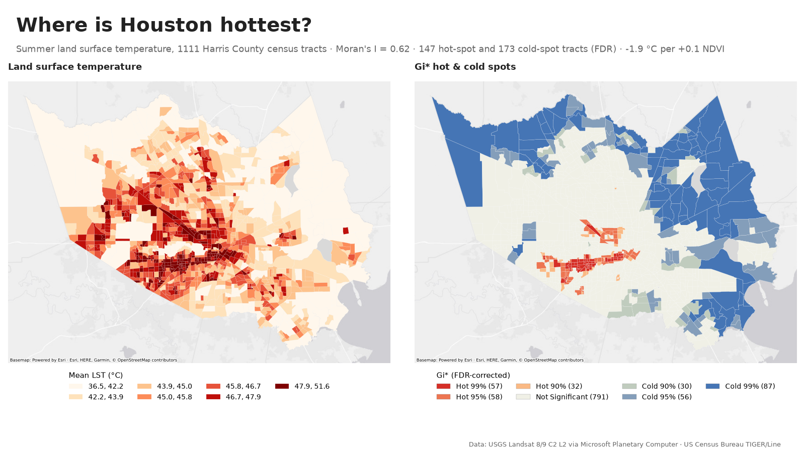
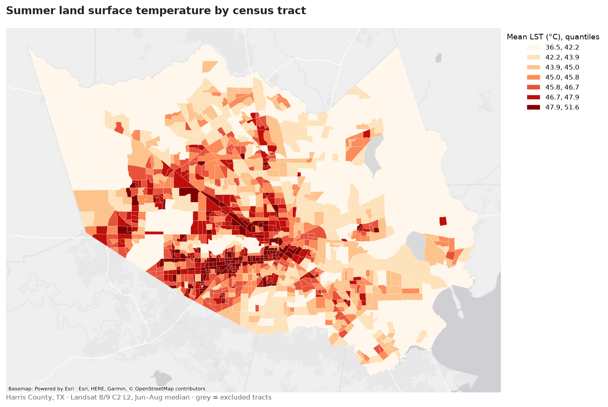
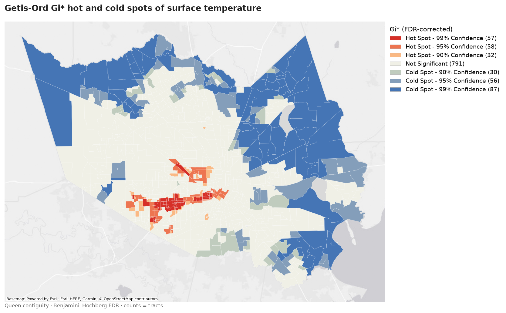
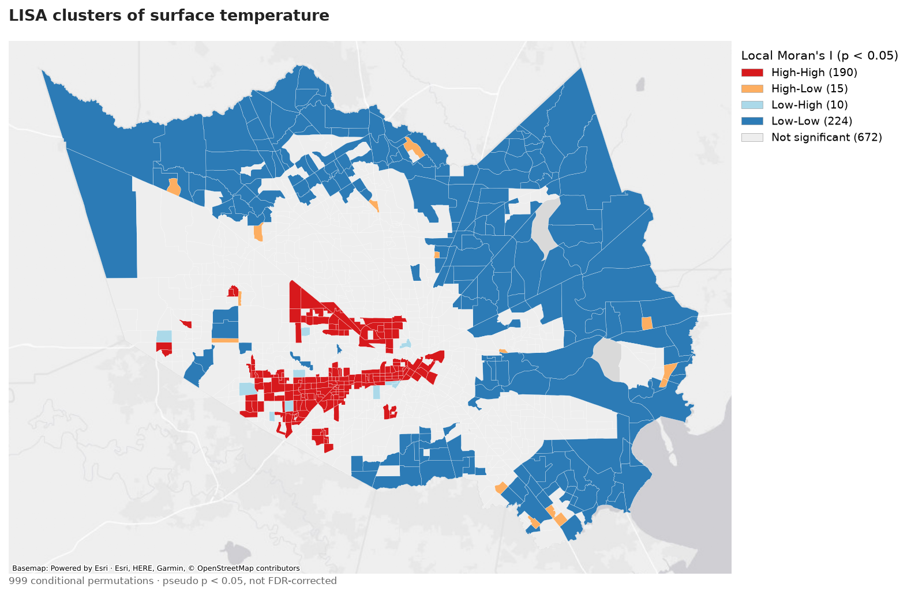
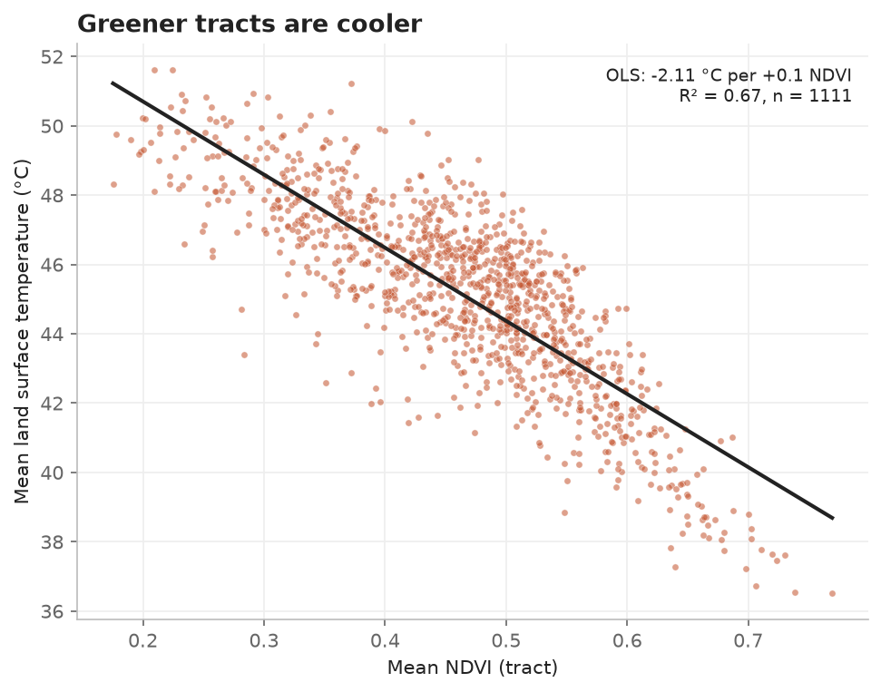

# Houston Heat Hotspots

**Where is Houston hottest in summer, and does vegetation explain it?** This project maps Landsat land surface temperature (LST) for every census tract in Harris County, Texas, finds statistically significant hot and cold spots, and tests how much of the pattern tract greenness (NDVI) explains once spatial autocorrelation is accounted for.



## Key results

Summer (June–August) 2024 + 2025 median composite, 63 Landsat 8/9 scenes on 36 acquisition dates, 90 m grid (median 11 clear observations per pixel). All numbers come from [`results/metrics.json`](results/metrics.json).

| | |
|---|---|
| Tracts analysed | **1,111** of 1,115 (2 dropped as mostly water, 2 for < 20 valid land pixels) |
| Tract mean LST | 36.5 – 51.6 °C (county mean 45.2 °C; 10th–90th percentile 41.6 – 48.3 °C) |
| Global Moran's I (LST) | **0.619**, z = 36.7, pseudo p = 0.001 (999 permutations) |
| Gi* hot spots (FDR) | **147 tracts** (57 at 99 %, 58 at 95 %, 32 at 90 % confidence) |
| Gi* cold spots (FDR) | **173 tracts** (87 at 99 %, 56 at 95 %, 30 at 90 % confidence) |
| LISA clusters (p < 0.05) | 190 High-High, 224 Low-Low, 15 High-Low, 10 Low-High |

- **Heat concentrates in the urban core**: the Gi* hot spots form a band along the southwest–downtown–east corridor and a second cluster just north of it; the forested north and east of the county and the edges near Galveston Bay are cold spots. Without the false-discovery-rate correction the counts would be 222 hot and 254 cold, so FDR removes about a third of the "significant" tracts.
- **Greener tracts are much cooler.** NDVI alone explains 67 % of the tract-to-tract variation in LST.

| Model (LST ~ NDVI, n = 1,111) | NDVI coefficient (SE) | °C per +0.1 NDVI | Fit | AIC | Moran's I of residuals |
|---|---|---|---|---|---|
| OLS | −21.10 (0.45) | −2.11 | R² = 0.669 | 4116.5 | 0.484 (p = 0.001) |
| Spatial lag (ML), ρ = 0.513 | −14.18 (0.52) direct | −2.91 total effect | pseudo-R² = 0.779 | 3723.6 | 0.180 (p = 0.001) |
| **Spatial error (ML), λ = 0.785** | **−18.60 (0.49)** | **−1.86** | pseudo-R² = 0.669 | **3540.5** | **0.010 (p = 0.268)** |

OLS residuals are strongly autocorrelated, and the Lagrange-multiplier tests favour the error model (robust LM-error = 365.8 vs robust LM-lag = 20.4). The **spatial error model** has the lowest AIC and is the only one that leaves no significant autocorrelation in its residuals, so it is the preferred model: **each +0.1 in tract NDVI is associated with about 1.9 °C lower summer surface temperature**. The OLS slope (−2.1 °C) is modestly inflated by spatially clustered omitted factors (impervious cover, building density, industry). The spatial lag total effect (−2.9 °C) is not preferred because its residuals remain autocorrelated. Pseudo-R² for the error model equals the OLS R² by construction (it is computed from Xβ only), so the models are compared on AIC and log-likelihood.

| LST by tract | Gi* hot / cold spots |
|---|---|
|  |  |
| **LISA clusters** | **LST vs NDVI** |
|  |  |

An interactive map with tract tooltips is in [`docs/map.html`](docs/map.html) (works as a GitHub Pages page).

## Method

1. **Tracts.** 2020 TIGER/Line census tracts for Texas, filtered to Harris County (COUNTYFP 201): 1,115 tracts.
2. **Imagery.** Landsat Collection 2 Level-2 (`landsat-c2-l2`) from the Microsoft Planetary Computer STAC API, Landsat 8 and 9, June–August of 2024 and 2025, scene cloud cover < 40 %. Scenes from the same day are mosaicked; data are loaded with `odc-stac` onto a 90 m UTM 15N grid (nearest-neighbour, so QA bits stay intact).
3. **Scaling and masking.** Surface temperature `ST_B10 × 0.00341802 + 149.0` K → °C; reflectance `SR × 0.0000275 − 0.2`. Pixels are masked where `QA_PIXEL` flags fill, dilated cloud, cirrus, cloud, cloud shadow or snow. NDVI = (NIR − Red)/(NIR + Red) from the same masked scenes. The composite is the per-pixel **median** of clear observations (at least 3 required). Pixels flagged as water in more than half of their clear observations are excluded.
4. **Zonal statistics.** Tracts are rasterised onto the composite grid (pixel-centre rule) and mean LST and NDVI are computed over valid land pixels. Tracts are dropped if more than 50 % of their pixels are water (or ALAND = 0) or if they have fewer than 20 valid pixels.
5. **Spatial weights.** Queen contiguity (shared edge or vertex), row-standardised. The design attaches any island tract to its nearest neighbour (k = 1 by centroid); in this run there were no islands and the graph is a single connected component (mean 6.6 neighbours).
6. **Autocorrelation.** Global Moran's I with 999 permutations. Getis-Ord **Gi\*** (binary weights including the tract itself, analytical z-scores as in ArcGIS Pro *Hot Spot Analysis*), two-sided p-values, **Benjamini–Hochberg FDR** correction, and Esri's 90/95/99 % confidence classes and colours. Local Moran's I (LISA) with 999 conditional permutations, pseudo p < 0.05 (not FDR-corrected).
7. **Regression.** OLS of tract LST on NDVI with spatial diagnostics (Moran's I of residuals, LM and robust LM tests), then maximum-likelihood spatial lag and spatial error models (`spreg`). For the lag model the total effect is β/(1 − ρ). AIC counts ρ (lag) and λ (error) as parameters, so the three models are compared on the same footing.

The optional equity covariate (ACS 5-year median household income, B19013) is wired in but was **not used in this run**: the Census Data API now asks for a key for this request. Set a free key in the `CENSUS_API_KEY` environment variable to include it (results would then show an association, not a causal effect).

## How to run

```bash
conda env create -f environment.yml
conda activate gis-portfolio
python run.py                        # Harris County, summers 2024 + 2025, 90 m
python run.py --resolution 60        # finer grid (slower)
python run.py --county 157 --years 2025   # e.g. Fort Bend County, one summer
pytest -q                            # fast unit tests, no network
```

Options: `--state`, `--county`, `--years`, `--resolution`, `--crs`, `--max-cloud`, `--min-pixels`, `--max-water`, `--no-income`, `--no-basemap`. A full run takes about one to three minutes, mostly reading imagery; the composite is cached in `data/cache/` (git-ignored) so reruns take seconds. If basemap tiles are unreachable, maps are drawn without them.

```
heat/data.py     tracts, ACS, Landsat search, scaling, QA masks, median composite
heat/zonal.py    rasterised zonal means and pixel counts
heat/stats.py    weights, Moran's I, Gi* + FDR, LISA, OLS / spatial lag / spatial error
heat/maps.py     figures and the folium map
run.py           pipeline entry point
tests/           scaling, QA bits, zonal means, BH-FDR, Moran's I on a synthetic lattice
results/         metrics.json, tracts.gpkg (tract attributes, Gi*, LISA)
```

## Limitations

- **LST is not air temperature.** Landsat measures the radiative temperature of surfaces (roofs, pavement, canopy) in mid-morning (Landsat crosses the equator around 10 a.m. local solar time). It is related to, but not the same as, the air temperature people feel, and it says nothing about night-time heat retention.
- **Single-season composite.** A median of two summers smooths weather but hides day-to-day and year-to-year variation; the thermal band is collected at 100 m and resampled by USGS, so tract means blur fine detail.
- **MAUP.** Results depend on the tract boundaries and the 90 m grid; other zones (block groups, hexagons) or resolutions would give somewhat different statistics.
- **Ecological fallacy.** Relationships are between tract averages; they do not describe individual blocks, buildings or residents.
- **Omitted variables.** NDVI stands in for a bundle of land-cover differences (impervious surface, building density, industrial land); the coefficient is an association, not the causal effect of planting trees.
- **Multiple testing.** Gi* uses FDR correction; LISA uses uncorrected pseudo p-values and should be read as exploratory.

## References

- Anselin, L. (1988). *Spatial Econometrics: Methods and Models*. Kluwer Academic.
- Anselin, L. (1995). Local indicators of spatial association — LISA. *Geographical Analysis*, 27(2), 93–115.
- Anselin, L., Bera, A. K., Florax, R., & Yoon, M. J. (1996). Simple diagnostic tests for spatial dependence. *Regional Science and Urban Economics*, 26(1), 77–104.
- Benjamini, Y., & Hochberg, Y. (1995). Controlling the false discovery rate: a practical and powerful approach to multiple testing. *Journal of the Royal Statistical Society, Series B*, 57(1), 289–300.
- Getis, A., & Ord, J. K. (1992). The analysis of spatial association by use of distance statistics. *Geographical Analysis*, 24(3), 189–206.
- Moran, P. A. P. (1950). Notes on continuous stochastic phenomena. *Biometrika*, 37(1/2), 17–23.
- Openshaw, S. (1984). *The Modifiable Areal Unit Problem*. Concepts and Techniques in Modern Geography 38. Geo Books.
- Ord, J. K., & Getis, A. (1995). Local spatial autocorrelation statistics: distributional issues and an application. *Geographical Analysis*, 27(4), 286–306.
- Rey, S. J., & Anselin, L. (2007). PySAL: A Python library of spatial analytical methods. *The Review of Regional Studies*, 37(1), 5–27.
- U.S. Geological Survey. *Landsat 8-9 Collection 2 (C2) Level 2 Science Product (L2SP) Guide* (LSDS-1619).

## Data credits

- Landsat 8 and 9 Collection 2 Level-2 imagery courtesy of the **U.S. Geological Survey**, accessed through the **Microsoft Planetary Computer**.
- 2020 TIGER/Line census tract boundaries: **U.S. Census Bureau**.
- Basemap tiles (static figures and `docs/map.html`): Esri World Light Gray Canvas. Powered by Esri; sources: Esri, HERE, Garmin, © OpenStreetMap contributors, and the GIS user community. Tiles are used under the [Esri terms of use](https://www.esri.com/en-us/legal/terms/full-master-agreement) and are not redistributed in this repository.

## License

MIT © 2026 Landon Melesky
